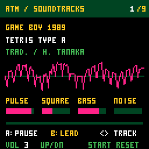

# ATM Soundtracks

See the [repository README](../README.md) for builds, all nine tracks, controls,
source setup and credits. See [NOTES.md](NOTES.md) for implementation details.

## Audio update 1.1.1

DC removal, increased output gain and bounded peak compression improve the four-voice music signal. All nine scores, original player controls and the default volume remain. The oscilloscope shows the unprocessed score mix. The new output helper is included locally, so builds use the existing pinned upstream SDK.

[Audio validation notes](docs/audio-update.md).
