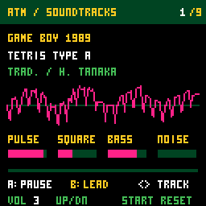

# Chiptune: ATM Soundtracks

A CHGame music demo using [ATMlib](https://github.com/T-arg/ATMlib).
Choose from nine classic NES and Game Boy themes, with a live oscilloscope
and four channel meters.



## Download

**[Latest release and all builds](https://github.com/juliendorra/chgame-soundtracks/releases/latest)**

| Build for CHGame Rev0 | Use |
|---|---|
| [ATM-Soundtracks-rev0.chgame](https://github.com/juliendorra/chgame-soundtracks/releases/latest/download/ATM-Soundtracks-rev0.chgame) | Shareable cartridge, with metadata and license notices |
| [ATM-Soundtracks-rev0.chg](https://github.com/juliendorra/chgame-soundtracks/releases/latest/download/ATM-Soundtracks-rev0.chg) | Firmware for the SD game menu |
| [ATM-Soundtracks-rev0.bin](https://github.com/juliendorra/chgame-soundtracks/releases/latest/download/ATM-Soundtracks-rev0.bin) | Raw firmware for USB upload |
| [ATM-Soundtracks-rev0.hex](https://github.com/juliendorra/chgame-soundtracks/releases/latest/download/ATM-Soundtracks-rev0.hex) | Intel HEX application image |
| [SHA256SUMS.txt](https://github.com/juliendorra/chgame-soundtracks/releases/latest/download/SHA256SUMS.txt) | Verify the downloaded builds |

Version **1.1.0** contains all nine tracks. The 38,920-byte release was
accepted by the Rev0 bootloader and started on a physical CHGame.
No additional SD data files are needed.

## Controls

| Button | Action |
|---|---|
| Left / Right | Previous / next track, wrapping around |
| A | Pause / resume at the same musical position |
| B | Compare melody only with the full arrangement |
| Up / Down | Volume, from silent to level 4 |
| START | Restart the current track |

## Playback

The demo starts playing immediately. All nine selections loop; switching
tracks restarts playback and retains volume and melody-only mode.

| Game | Selection | Length |
|---|---|---|
| Tetris | Type A / Korobeiniki | 40 s |
| Super Mario Bros. | Overworld | 77.5 s |
| The Legend of Zelda | Main theme | 67 s |
| Mega Man 2 | Dr. Wily Stage 1 | 87.8 s |
| DuckTales | The Moon | 79.2 s |
| Castlevania | Vampire Killer | 90.7 s |
| Metroid | Brinstar | 98.2 s |
| Kirby's Dream Land | Green Greens | 82.2 s |
| Pokémon Red/Blue | Trainer Battle | 170.7 s |

The original three melodies follow attributed note transcriptions, with new
backing arrangements. The six additions retain melody, supporting parts,
bass and percussion timing from credited MIDI transcriptions. MIDI chords
are reduced to chip voices, low/high notes shifted into the engine's range,
and note endpoints quantized to 24 ticks per quarter note. Pokémon's reference
uses three melodic channels and keeps the noise lane silent. These are
four-voice adaptations, not bit-perfect NES/Game Boy soundtrack emulation.
CHGame's piezo also changes the timbre and weakens the low bass.

## Run it

For a prebuilt cartridge, download the `.chgame` file above. With the CHGame
tools installed, flash it with:

```sh
chgame cart flash ATM-Soundtracks-rev0.chgame
```

For the SD game menu, prepare the cartridge onto a card using the CHGame cart
tools, or install the `.chg` build using your normal CHGame SD menu workflow.
Holding START returns to the usual CHGame menu.

## Build from source

Install Git, Python 3.12 or newer, Arduino CLI and Clang (`clang++`, for host
tests). Then clone this repository with its pinned CHGame dependency:

```sh
git clone --recurse-submodules https://github.com/juliendorra/chgame-soundtracks.git
cd chgame-soundtracks
python3 chiptune.py setup
python3 chiptune.py build
python3 chiptune.py export --no-build
```

Setup installs board package `CHGame:ch32v@0.3.0` and the pinned Python
dependencies into a local `.venv`. Arduino packages and caches stay inside
the checkout. Existing Arduino environments can be selected using the
`ARDUINO_CONFIG_FILE` and `ARDUINO_DIRECTORIES_*` environment variables.

The firmware is `Chiptune/build/release/Chiptune.ino.bin`; the cartridge is
`Chiptune/build/Chiptune.chgame`. Upload a local build with
`python3 chiptune.py upload`, or flash a downloaded binary without compiling:

```sh
python3 chiptune.py uploader flash ATM-Soundtracks-rev0.bin --device rev0 --run
```

Run the audio and simulator checks with `python3 chiptune.py test`.
Regenerate the preview with `python3 chiptune.py gif`. Generated WAVs are in
`Chiptune/out/audio/`. Neither testing nor packaging uploads to the device.

## Developer notes

- `Chiptune/Synth.cpp` ports ATMlib's real command interpreter and effects, with
  simultaneous pulse, square, triangle bass and noise synthesis.
- TIM1 channel 2 on PB10 outputs 187.5 kHz PWM. TIM3 supplies 31,250 samples
  per second; the millisecond hook advances the tracker at the score's BPM.
- The sample mixer and interrupt handler run from SRAM. A double buffer
  publishes voice controls between the tracker and sample interrupt.
- `Chiptune/tools/melodies.json` holds the editable note transcriptions;
  `Chiptune/tools/make_songs.py` generates compact ATM songs with shared phrases.
  `Chiptune/tools/import_classics.py` reproduces the six additions from the source MIDIs.
  The port is reproducible
  from the pinned upstream files with `Chiptune/tools/port_atmlib.py`.
- [implementation notes](Chiptune/NOTES.md) records verification, source details and limitations.

## Credits

ATMlib: Davey Taylor (STG), Joeri Gantois (JO3RI), TEAM a.r.g., BSD 3-Clause.
Melody reference transcriptions: Robson Couto's
[arduino-songs](https://github.com/robsoncouto/arduino-songs).
Super Mario Bros. and The Legend of Zelda: Koji Kondo / Nintendo.
Tetris Type A: traditional *Korobeiniki*, game arrangement by Hirokazu Tanaka.
Additional MIDI references: VGMusic sequences credited to DurfarC, Jorge D.
Fuentes, Jay Reichard, Heat Man, João "Johnnyz" Buaes, and an uncredited Wily
sequencer. Composer credits and source links are in `Chiptune/tools/melodies.json`.
See [NOTICE](NOTICE) and [LICENSE](LICENSE).
